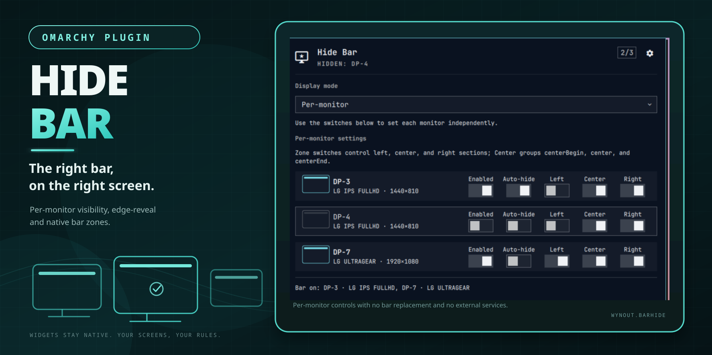
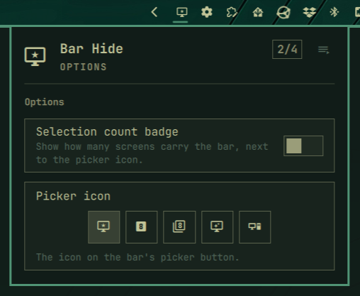

# Hide Bar



Hide the Omarchy top bar per monitor — pick which screens show the bar
through a picker in the bar itself. In a multi-monitor setup you pin the
bar to one monitor or several; unselected screens get no bar, and with
nothing selected the native bar-on-every-screen behavior applies.
Selection is live and happens inside the bar — no config edits needed —
and every other bar widget keeps working as-is.

## Why hide the bar per monitor?

Bar space is precious on mixed screen sizes — a TV or projector that only
shows video does not need a bar, while your main display does. Hide Bar
gives you per-screen bar control straight from the native bar: hide it on
some monitors, show it on others, or leave it everywhere. It is the
multi-monitor answer to Omarchy's single bar-hidden toggle, which affects
all screens at once.

Built for Omarchy 4 (Quattro). Hide Bar is an ordinary bar-widget plugin: it
does not replace the native bar. Every picker instance lives inside its
screen's bar panel and parks that panel when the screen is not selected —
the same mechanism the native bar-hidden toggle uses. Widgets, layout,
theming and popouts stay Omarchy-owned.

### Version compatibility

Omarchy 4.5 redesigned the bar: its panel used to be the 26px strip itself
and now spans the whole screen, with the strip drawn inside it. Hide Bar
detects the panel shape and adapts in both directions — park distance and
exclusion mode switch accordingly — so 0.5.0 works on Omarchy 4.0–4.4 and
4.5+ alike. 0.4.1 and older only work before 4.5 (on 4.5 they leave the bar
unreserved, with tiled windows sliding under it).

0.5.1 fixes the same release moving the goalposts on the other axis: 4.5
added the `centerBegin`/`centerEnd`/`tray` bar sections, and a widget parked
in one of them (e.g. the tray) was invisible to the shared state's parser,
which still scanned only `left`/`center`/`right`. Its selection then parsed
as empty — the plugin's "bar on every screen" fallback — and no selection
made in the picker could stick. 0.5.1 reads the section list from the
native `Util.barSections` instead of a hardcoded array.

Maintenance note: the dual-mode plumbing (`spanningPanel` in `Picker.qml`)
is a compatibility shim, kept until older Omarchy is retired. When 4.5+ is
the floor, delete `spanningPanel`, pin the exclusion Binding to `Normal` and
the park offset to `-hostWindow.implicitHeight`.

## Install and remove

```sh
# install + enable (places the picker in the bar's right section)
omarchy plugin add https://github.com/wynout/omarchy-barhide.git --enable
omarchy plugin enable wynout.barhide --section right
omarchy restart shell

# remove
omarchy plugin remove wynout.barhide
omarchy restart shell
```

(The plugin is not a bar replacement, so no `omarchy bar use` is needed.)

## Usage

Click the picker icon in the bar to open the screen list (screenshot at the
top of this page). Choose a global **Display mode**:

- **Per-monitor** — use each screen's Enabled, Auto-hide, Left, Center, and
  Right switches.
- **Show everywhere** — reset per-screen bar and zone overrides; all bars and
  sections become visible.
- **Auto-hide everywhere** — enable all bars and reveal them at their screen
  edges on demand. Saved section-zone choices remain in effect.

**Show everywhere** clears the widget entry's saved Enabled, Auto-hide, and
section choices. A hand-edited `bar.barhide` override remains
authoritative in **Per-monitor** mode. **Auto-hide everywhere** temporarily
overrides the per-monitor bar choices. While **Show everywhere** is active,
clicking a monitor's Enabled switch returns to **Per-monitor** and hides that
screen. Clicking Auto-hide or a zone switch in either global mode returns to
**Per-monitor** and applies the requested setting to that screen. Other saved
per-monitor choices resume where they exist. Use Omarchy's global bar-off
toggle when you want every bar hidden.

Screens you showed that are currently disconnected stay in the list (their
bar returns when they do) and show up in a "not connected" section with a
**forget** button.

### Per-monitor settings

In **Per-monitor** mode, each screen has five independent switches:
**Enabled** controls whether its bar appears, **Auto-hide** selects
edge-reveal behavior, and **Left**, **Center**, and **Right** control the
sections. All five controls line up in one row.

- **Enabled off** — the bar is hidden on that screen.
- **Enabled on, Auto-hide off** — the bar stays visible.
- **Enabled on, Auto-hide on** — the bar stays out of the way until you touch
  that screen's bar edge.
Auto-hide can be configured while a screen is disabled. It does not enable or
disable that screen; turning Enabled back on restores its saved Auto-hide
choice.

**Center** controls Omarchy 4.5's `centerBegin`, `center`, and `centerEnd`
sections together. Hidden sections give their space back to the other bar
widgets, but remain mounted, so their background services may keep running.
Section discovery follows Omarchy 4.5's internal `ModuleList` markers, so a
future bar rewrite may require adapting this part of the plugin.

Autohide is available with Omarchy 4.5+'s full-screen bar panel. It keeps the
bar's space unreserved, reveals over the workspace, and hides it again after
the pointer leaves the bar and any open bar popout. The global Omarchy bar-off
toggle still hides every screen and takes precedence. On older panel layouts,
the original per-screen show/hide behavior remains available; Auto-hide and
section-zone controls are disabled.

Per-monitor settings are stored in `monitors`, `autohideMonitors`, and
`sectionZones`. The selected global mode is
stored in `displayMode`:

```json
{
  "id": "wynout.barhide",
  "displayMode": "per-monitor",
  "monitors": [],
  "autohideMonitors": [
    { "name": "DP-1", "model": "LG ULTRAGEAR", "serial": "123abc456" }
  ],
  "sectionZones": [
    {
      "screen": { "name": "DP-1", "model": "LG ULTRAGEAR", "serial": "123abc456" },
      "left": false,
      "center": true,
      "right": false
    }
  ]
}
```

In **Per-monitor** mode, an empty `monitors` list means the bar is enabled on
every screen.

Settings persist in Hide Bar's own entry in `bar.layout` inside
`~/.config/omarchy/shell.json`:

```json
{
  "id": "wynout.barhide",
  "monitors": [
    { "name": "HDMI-A-1", "model": "LG ULTRAGEAR", "serial": "123abc456" }
  ]
}
```

List entries can be plain strings (case-insensitive substring of model or
name) or full `{ name, model, serial }` references. Matching scores every
connected screen against the stored reference — name +2, serial +1,
model +1 — and the single highest-scoring screen wins; a genuine tie
refuses to guess. Config written by older versions (`primary`/`secondary`
keys) keeps working and is rewritten in the new shape on the next save.

A hand-edit override under `bar.barhide` takes precedence over the
widget's own entry:

```json
"bar": {
  "barhide": {
    "displayMode": "per-monitor",
    "monitors": ["ultragear", "eDP-1"],
    "autohideMonitors": ["eDP-1"],
    "showCountBadge": false
  }
}
```

## Options

The cog in the popup's hero opens the options page:



- **Selection count badge** — `showCountBadge` (default `true`): shows how
  many screens carry the bar, next to the picker icon.
- **Picker icon** — `pickerGlyph` (default `md-monitor-star`): pick one of
  a few monitor-themed Nerd Font glyphs for the picker button.

Choices persist in the widget's own entry; the `bar.barhide` override
accepts both options too.

## How it works

Each picker instance resolves its selection from the live shell.json and
parks its own host panel when that screen is not selected: a negative margin
past the active edge plus `ExclusionMode.Ignore`, the mechanism the native
bar-hidden toggle uses. Parking includes the global `omarchy toggle bar off`
flag, so that toggle keeps working on top of Hide Bar. All pickers share one
state object (`singles/BarHideState.qml`): a single shell.json watcher, one
bar-off probe (re-probed on a 15s fallback timer, since the directory watch
can go quiet after rapid flag changes), and one resolved selection — so
screens cannot disagree about park state. Parking decisions wait until the
config file has been read once; at startup the native bar-on-every-screen
behavior applies until then.

The selection write goes through the widget's own `updateEntryInline`, the
same write path the built-in clock uses for its format cycling.

On supported full-screen panels, an autohide-enabled screen uses a separate
two-pixel edge `PanelWindow` so its parked bar can still be revealed. The
native bar panel slides only between its parked edge position and the screen
edge, with `ExclusionMode.Ignore` throughout; windows do not move when the bar
appears. The trigger is screen-local, and the native bar remains responsible
for widgets and popouts. While revealing over a fullscreen window, the plugin
temporarily promotes the bar surface and restores its input region only to the
bar strip.

## Development

```sh
PLUGIN_DIR=~/.config/omarchy/plugins/wynout.barhide
omarchy plugin validate "$PLUGIN_DIR"
qmllint -I "$OMARCHY_PATH/shell" "$PLUGIN_DIR/Picker.qml" "$PLUGIN_DIR/Panel.qml"
```

Note: the shell caches plugin QML components; file edits only hot-reload the
registry, so run `omarchy restart shell` to load changed code.

## License and attribution

Hide Bar is licensed under the MIT License. Adapted third-party portions and
their MIT notices are documented in [THIRD_PARTY_NOTICES.md](THIRD_PARTY_NOTICES.md).
